<h1 align="center">termaid</h1>

<p align="center">Render Mermaid diagrams in your terminal or Python app.</p>

<p align="center">
  
</p>

**[Try it online at termaid.com](https://termaid.com)**

## Features

- 18 diagram types: flowcharts, sequence, class, ER, state, block, git, gantt, architecture, pie, treemap, mindmap, timeline, kanban, quadrant, XY chart, user journey, and packet
- No dependencies. The core is pure Python
- Fits the terminal width: it tightens spacing first, then wraps labels at word boundaries
- Colored output with Rich and a TUI widget for Textual, as optional extras, with 11 themes
- `--ascii` for terminals without box-drawing characters
- Reads from a file or stdin: `cat diagram.mmd | termaid`
- Draws the Mermaid blocks in a Markdown file, or in Claude Code's replies, in place

## Why?

Mermaid is great for documentation, but rendering it usually means spinning up a browser or calling an external service. termaid lets you render diagrams over SSH, in CI logs, inside TUI apps, or anywhere you have a Python environment. I built it because the existing tools in this space, like [mermaid-ascii](https://github.com/AlexanderGrooff/mermaid-ascii) (Go) and [beautiful-mermaid](https://github.com/lukilabs/beautiful-mermaid) (TypeScript), don't offer a native Python library you can import and call directly.

## Install

### Pip

```bash
pip install termaid
```

### Homebrew

```bash
brew install termaid
```

Or try it without installing:

```bash
uvx termaid diagram.mmd
```

## Quick start

### CLI

```bash
termaid diagram.mmd
echo "graph LR; A-->B-->C" | termaid
termaid diagram.mmd --theme neon
termaid diagram.mmd --ascii
termaid --markdown README.md          # draw every ```mermaid block in a document
gh pr view 42 | termaid --markdown
```

### Python

```python
from termaid import render

print(render("graph LR\n  A --> B --> C"))
```

```python
# Colored output (requires: pip install termaid[rich])
from termaid import render_rich
from rich import print as rprint

rprint(render_rich("graph LR\n  A --> B", theme="terra"))
```

```python
# Textual TUI widget (requires: pip install termaid[textual])
from termaid import MermaidWidget

widget = MermaidWidget("graph LR\n  A --> B")
```

## Supported diagram types

### Flowcharts

All directions supported: `LR`, `RL`, `TD`/`TB`, `BT`.

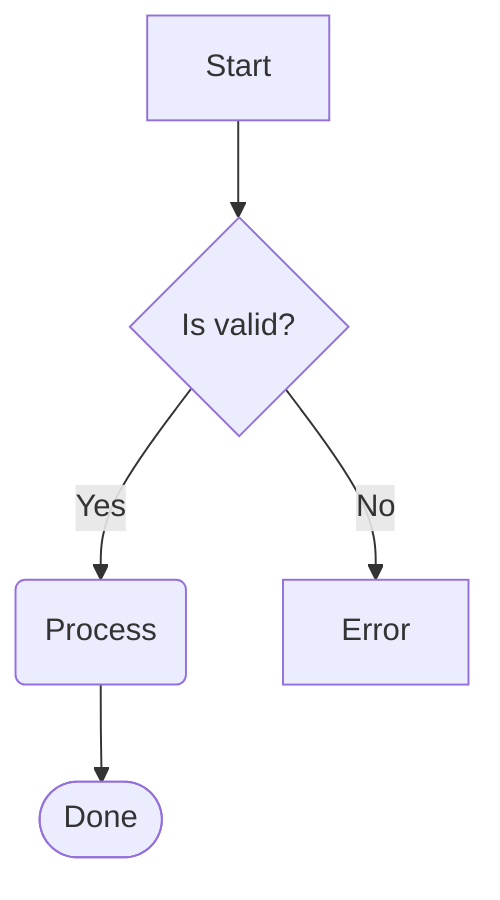

```
┌─────────────┐
│             │
│    Start    │
│             │
└──────┬──────┘
       │
       │
       ▼
┌──────◇──────┐
│             │
│  Is valid?  │
│             │
└──────◇──────┘
       │
       │
       ╰──────────────────╮
    Yes│                  │No
       ▼                  ▼
╭─────────────╮    ┌─────────────┐
│             │    │             │
│   Process   │    │    Error    │
│             │    │             │
╰──────┬──────╯    └─────────────┘
       │
       │
       ▼
╭─────────────╮
(             )
(    Done     )
(             )
╰─────────────╯
```

**Node shapes:** rectangle `[text]`, rounded `(text)`, diamond `{text}`, stadium `([text])`, subroutine `[[text]]`, circle `((text))`, double circle `(((text)))`, hexagon `{{text}}`, cylinder `[(text)]`, asymmetric `>text]`, parallelogram `[/text/]`, trapezoid `[/text\]`, and `@{shape}` syntax

**Edge styles:** solid `-->`, dotted `-.->`, thick `==>`, bidirectional `<-->`, circle endpoint `--o`, cross endpoint `--x`, labeled `-->|text|`, variable length `--->`, `---->`

**Styling:** `classDef`, `style`, `linkStyle` directives, `:::className` suffix

**Subgraphs:** nesting, cross-boundary edges, per-subgraph `direction` override

**Other:** `%%` comments, `;` line separators, Markdown labels `` "`**bold** *italic*`" ``, `&` operator (`A & B --> C`), entity codes (`#quot;`, `#amp;`, `#9829;`)

### Sequence diagrams

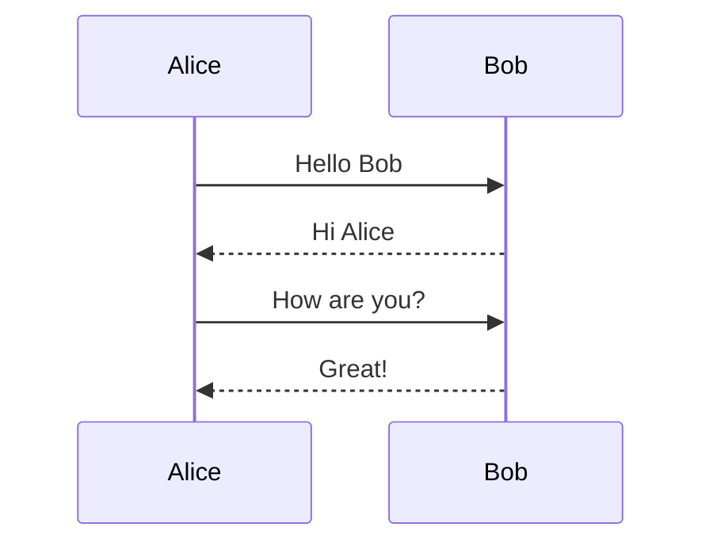

```
 ┌──────────┐      ┌──────────┐
 │  Alice   │      │   Bob    │
 └──────────┘      └──────────┘
       ┆ Hello Bob       ┆
       ──────────────────►
       ┆ Hi Alice        ┆
       ◄┄┄┄┄┄┄┄┄┄┄┄┄┄┄┄┄┄┄
       ┆ How are you?    ┆
       ──────────────────►
       ┆ Great!          ┆
       ◄┄┄┄┄┄┄┄┄┄┄┄┄┄┄┄┄┄┄
       ┆                 ┆
```

**Message types:** solid arrow `->>`, dashed arrow `-->>`, solid line `->`, dashed line `-->`

**Participants:** `participant`, `actor`, aliases

### Class diagrams

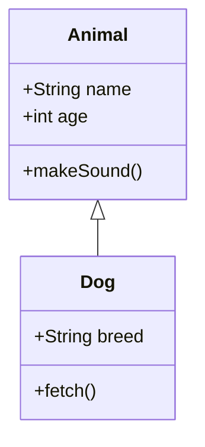

```
  ┌──────────────┐
  │    Animal    │
  ├──────────────┤
  │ +String name │
  │ +int age     │
  ├──────────────┤
  │ +makeSound() │
  └──────────────┘
          △
          │
          │
          │
  ┌───────────────┐
  │      Dog      │
  ├───────────────┤
  │ +String breed │
  ├───────────────┤
  │ +fetch()      │
  └───────────────┘
```

**Relationships:** inheritance `<|--`, composition `*--`, aggregation `o--`, association `--`, dependency `..>`, realization `..|>`

**Members:** attributes and methods with visibility (`+` public, `-` private, `#` protected, `~` package)

### ER diagrams

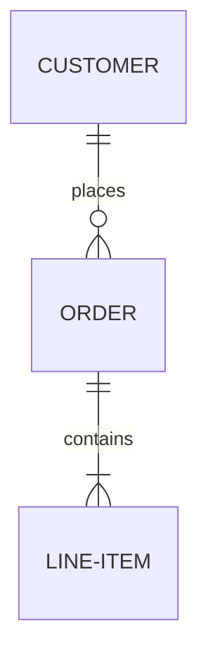

```
  ┌──────────────┐
  │   CUSTOMER   │
  └──────────────┘
          │1
          │ places
          │
          │0..*
  ┌──────────────┐
  │    ORDER     │
  └──────────────┘
          │1
          │ contains
          │
          │1..*
  ┌──────────────┐
  │  LINE-ITEM   │
  └──────────────┘
```

**Cardinality:** `||` (exactly one), `o|` (zero or one), `}|` (one or more), `o{` (zero or more)

**Line styles:** solid `--`, dashed `..`

**Attributes:** type, name, keys (`PK`, `FK`, `UK`), comments

### State diagrams

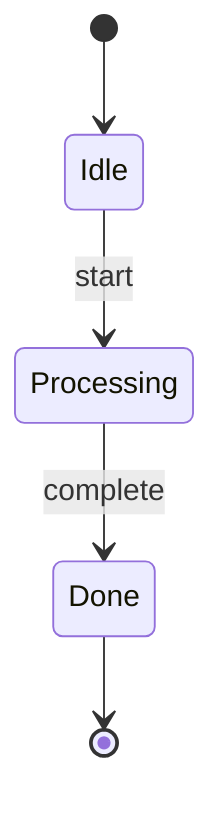

```
╭───────◯──────╮
│              │
│      ●       │
│              │
╰───────◯──────╯
        │
        │
        ▼
╭──────────────╮
│              │
│     Idle     │
│              │
╰───────┬──────╯
        │
   start│
        ▼
╭──────────────╮
│              │
│  Processing  │
│              │
╰───────┬──────╯
        │
complete│
        ▼
╭──────────────╮
│              │
│     Done     │
│              │
╰───────┬──────╯
        │
        │
        ▼
╭───────◯──────╮
│              │
│      ◉       │
│              │
╰───────◯──────╯
```

**Features:** `[*]` start/end states, transition labels, `state "name" as alias`, composite states (`state Parent { }`), stereotypes (`<<choice>>`, `<<fork>>`, `<<join>>`)

### Block diagrams

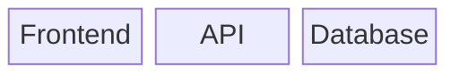

```
  ┌──────────┐    ┌──────────┐    ┌──────────┐
  │          │    │          │    │          │
  │ Frontend │    │   API    │    │ Database │
  │          │    │          │    │          │
  └──────────┘    └──────────┘    └──────────┘
```

**Features:** `columns N`, column spanning (`blockname:N`), links between blocks, nested blocks

### Git graphs

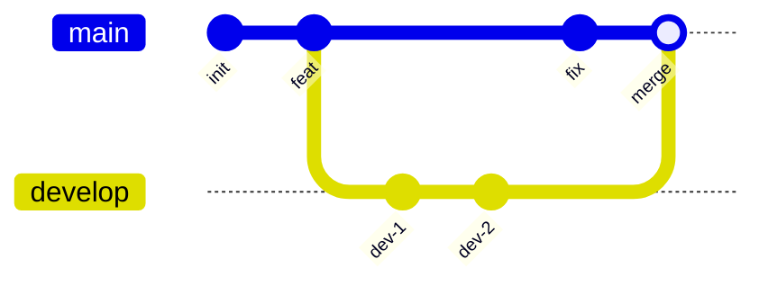

```
  main    ───●─────●──────┼──────────────●──────●─
           init  feat     │             fix   merge
                          │                     │
  develop                 ●───────●─────────────┼
                        dev-1   dev-2
```

**Directions:** `LR` (default), `TB`, `BT`

**Commands:** `commit` (with `id:`, `type:`, `tag:`), `branch` (with `order:`), `checkout`/`switch`, `merge`, `cherry-pick`

**Commit types:** `NORMAL` (●), `REVERSE` (✖), `HIGHLIGHT` (■)

**Config:** `%%{init: {"gitGraph": {"mainBranchName": "master"}}}%%`

### Gantt charts

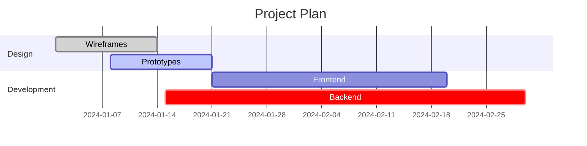

```
                                          Project Plan

 Design          │
   Wireframes    │░░░░░░░░░░░░░
   Prototypes    │       ▓▓▓▓▓▓▓▓▓▓▓▓▓
 Development     │
   Frontend      │                    ██████████████████████████████
   Backend       │              ███████████████████████████████████████████████
                 └┬─────────┬─────────┬─────────┬─────────┬─────────┬─────────┬
               Jan 01    Jan 11    Jan 21    Jan 31    Feb 10    Feb 20    Mar 01
```

**Tasks:** `done`, `active`, `crit`, `milestone` tags, `after id` dependencies, durations in Mermaid's units (`30d`, `2w`, `3M`, `1.5h`, `45m`, `1.2s`, `406ms`)

**Time scales:** any span from years to milliseconds. `dateFormat YYYY-MM-DD HH:mm` keeps the time of day, `dateFormat x` and `X` read Unix milliseconds and seconds, `axisFormat %H:%M` (or `%S.%L`) labels the axis, and `tickInterval 6hour` places the ticks

### Pie charts

Yes, the syntax says `pie`. No, we don't draw a circle. I know. Have you ever tried to read a pie chart made of `█` and `▓`? Exactly. We render them as horizontal bar charts instead.

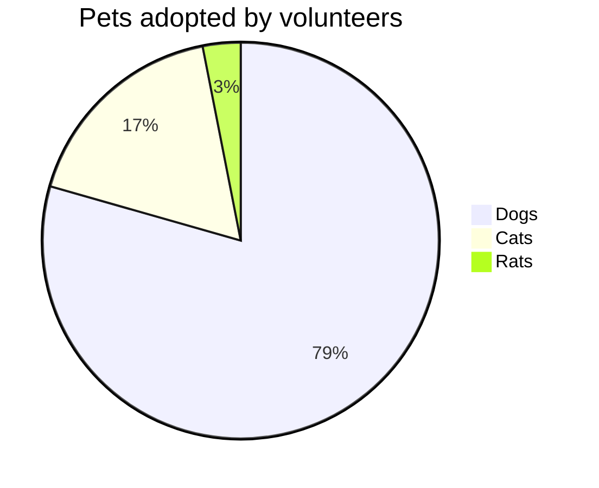

```
  Dogs┃████████████████████████████████  79.4%
  Cats┃▓▓▓▓▓▓▓  17.5%
  Rats┃░   3.1%
```

**Features:** `title`, `showData` (display raw values), `%%` comments

### Treemaps

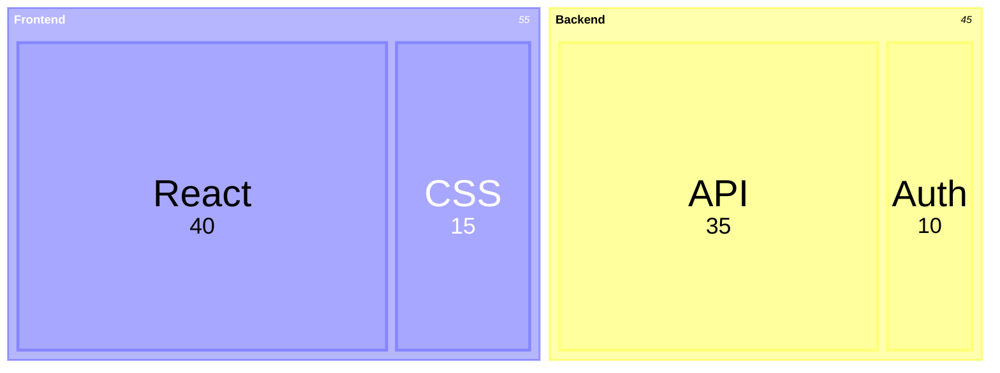

```
┌┄┄┄┄┄┄┄┄┄┄┄┄┄┄┄┄┄┄┄┄┄┄┄┄┄┄┄┄┄┄┄┄┄┄┄┐ ┌┄┄┄┄┄┄┄┄┄┄┄┄┄┄┄┄┄┄┄┄┄┄┄┄┄┄┄┄┐
┆             Frontend              ┆ ┆          Backend           ┆
┆┌───────────────────────┐ ┌───────┐┆ ┆┌───────────────────┐ ┌────┐┆
┆│         React         │ │  CSS  │┆ ┆│        API        │ │Auth│┆
┆│          40           │ │  15   │┆ ┆│        35         │ │ 10 │┆
┆│                       │ │       │┆ ┆│                   │ │    │┆
┆└───────────────────────┘ └───────┘┆ ┆└───────────────────┘ └────┘┆
└┄┄┄┄┄┄┄┄┄┄┄┄┄┄┄┄┄┄┄┄┄┄┄┄┄┄┄┄┄┄┄┄┄┄┄┘ └┄┄┄┄┄┄┄┄┄┄┄┄┄┄┄┄┄┄┄┄┄┄┄┄┄┄┄┄┘
```

**Features:** nested sections via indentation, `"label": value` syntax, proportional sizing, `%%` comments

### Mindmaps

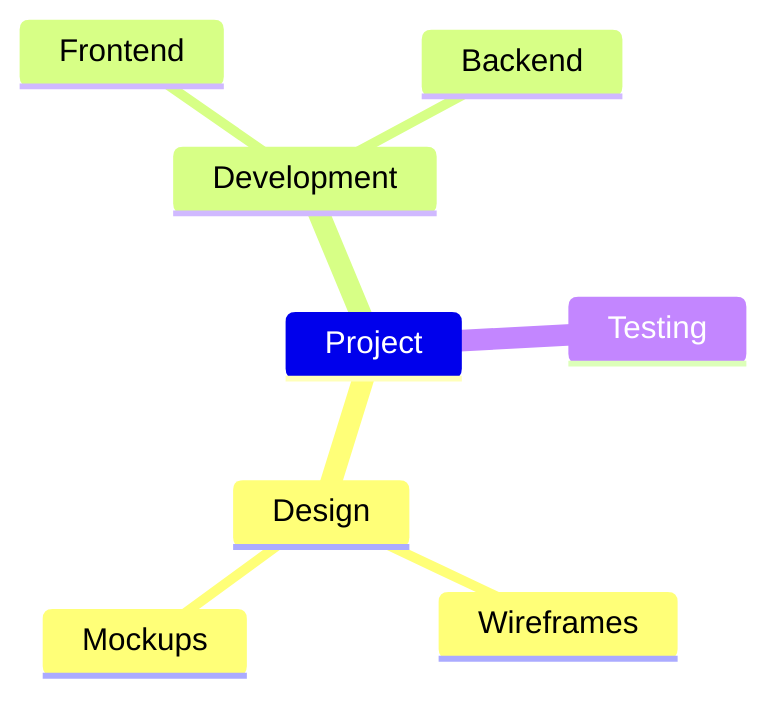

```
          ╭─ Design ──╭─ Wireframes
          │           ╰─ Mockups
Project ──├─ Development ──╭─ Frontend
          │                ╰─ Backend
          ╰─ Testing
```

**Features:** indentation-based nesting, automatic overflow to the left when many children, rounded/sharp/ASCII branch characters, Mermaid shape markers stripped (`(round)`, `[square]`, `{{hexagon}}`, `)cloud(`)

### XY charts

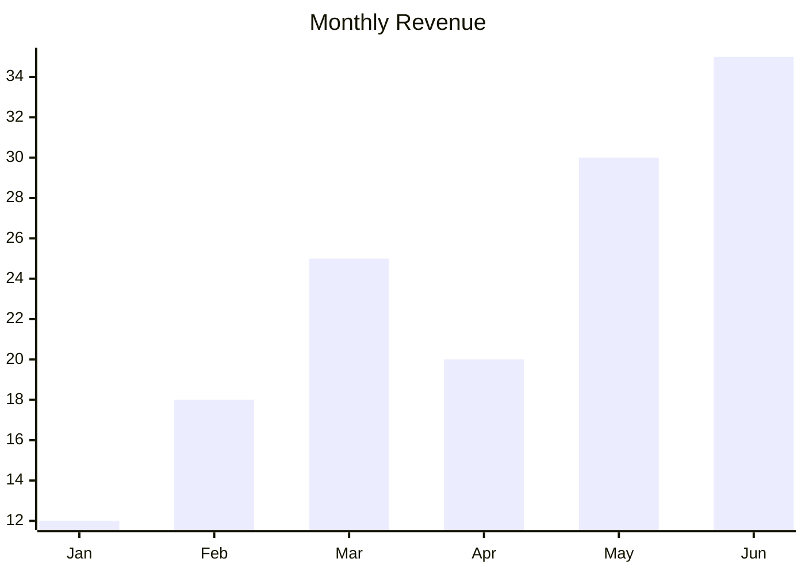

```
                 Monthly Revenue

     35 │                              ████
        │                              ████
        │                        ▄▄▄▄  ████
     28 │                        ████  ████
        │            ▄▄▄▄        ████  ████
        │            ████        ████  ████
     21 │            ████  ▄▄▄▄  ████  ████
        │      ▄▄▄▄  ████  ████  ████  ████
        │      ████  ████  ████  ████  ████
     14 │      ████  ████  ████  ████  ████
        │████  ████  ████  ████  ████  ████
        │████  ████  ████  ████  ████  ████
      7 │████  ████  ████  ████  ████  ████
        │████  ████  ████  ████  ████  ████
        │████  ████  ████  ████  ████  ████
      0 └──┬─────┬─────┬─────┬─────┬─────┬─
          Jan   Feb   Mar   Apr   May   Jun
```

**Features:** bar charts, line charts, bar+line combos, horizontal orientation (`xychart horizontal`), axis labels, `xychart` and `xychart-beta` keywords, rounded/sharp line corners, JSON ingest

### User journeys

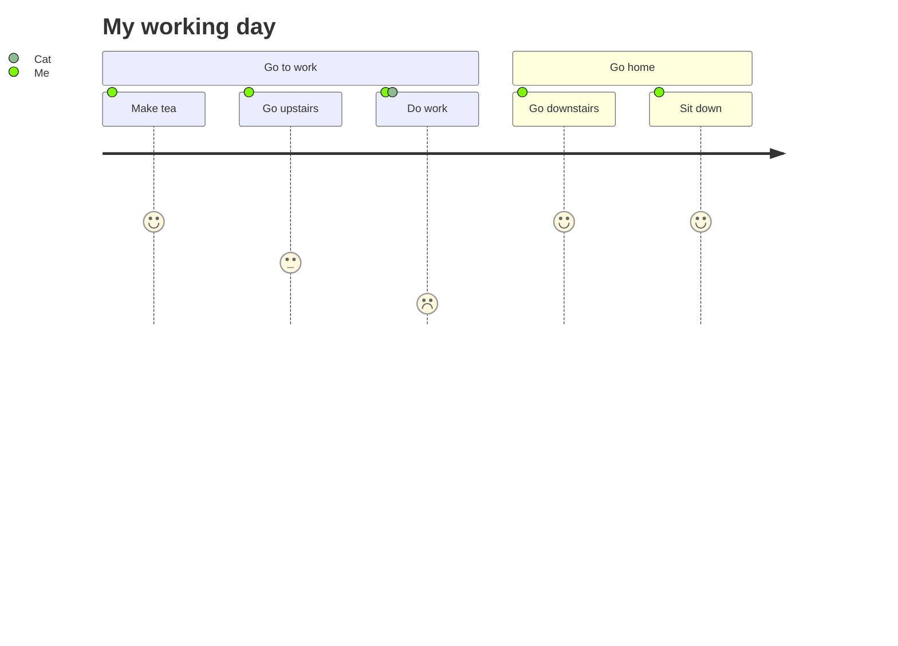

```
  My working day

  ● Cat
  ◆ Me

  ╭───────────── Go to work ──────────────╮   ╭───────── Go home ───────────╮

  ╭◆─────────╮ ╭◆────────────╮ ╭●◆───────╮    ╭◆──────────────╮ ╭◆─────────╮
 ─│ Make tea │─│ Go upstairs │─│ Do work │────│ Go downstairs │─│ Sit down │────►
  ╰──────────╯ ╰─────────────╯ ╰─────────╯    ╰───────────────╯ ╰──────────╯
       😄            😐            😞                😄              😄
```

**Features:** sections, satisfaction scores (😞-😄), multi-actor support with distinct symbols (●◆■▲), rounded/sharp/ASCII corners

### Packet diagrams

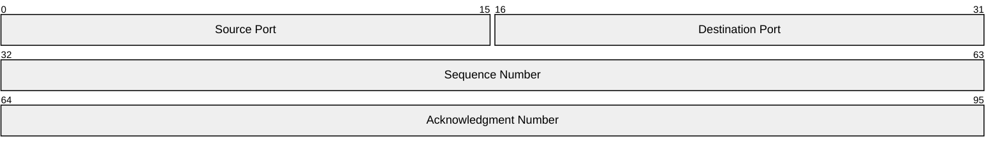

```
 0                                             15 16                                           31
 ╭───────────────────────────────────────────────┬───────────────────────────────────────────────╮
 │                 Source Port                   │               Destination Port                │
 ╰───────────────────────────────────────────────┴───────────────────────────────────────────────╯
 32                                                                                            63
 ╭───────────────────────────────────────────────────────────────────────────────────────────────╮
 │                                       Sequence Number                                         │
 ╰───────────────────────────────────────────────────────────────────────────────────────────────╯
 64                                                                                            95
 ╭───────────────────────────────────────────────────────────────────────────────────────────────╮
 │                                    Acknowledgment Number                                      │
 ╰───────────────────────────────────────────────────────────────────────────────────────────────╯
```

**Features:** bit-aligned field layouts, boundary numbers, auto-increment (`+N`) syntax, separated boxes per row, truncated label legend with bit ranges, `packet` and `packet-beta` keywords

## CLI options

| Flag | Description |
|------|-------------|
| `--ascii` | ASCII-only output (no Unicode box-drawing) |
| `--theme NAME` | Color theme (requires `pip install termaid[rich]`). Use `--themes` to list |
| `--themes` | List all available color themes |
| `--demo [TYPE]` | Render sample diagrams (`all`, `flowchart`, `sequence`, `mindmap`, etc.) |
| `--padding-x N` | Horizontal padding inside boxes (default: 4) |
| `--padding-y N` | Vertical padding inside boxes (default: 2) |
| `--gap N` | Space between nodes (default: 4). Use `1` or `2` for compact diagrams |
| `--inline-edge-labels` | Attach flowchart labels directly to their edges |
| `--width N` | Max output width. Re-renders with smaller gap/padding, then wraps labels, if exceeded |
| `--strict-width` | Exit with status 2 instead of a warning when the output is still wider than `--width` |
| `--max-height ROWS` | Exit with status 2 when the output has more than `ROWS` lines (a check, not a fitting target) |
| `--no-auto-fit` | Disable automatic compaction when diagram exceeds terminal width |
| `--sharp-edges` | Sharp corners on edge turns instead of rounded |
| `-o FILE` | Write output to file instead of stdout |
| `--show-ids` | Show node IDs alongside labels for debugging (e.g. `myId: My Label`) |
| `--json TYPE` | Pipe JSON/tabular data and render as `treemap`, `pie`, `mindmap`, `flowchart`, or `xychart` |
| `--markdown` | Read a Markdown document and draw each `mermaid` code block in place; other text passes through. A block that cannot be drawn is kept as source, with a warning |
| `--claude-hook` | Run as a Claude Code `MessageDisplay` hook: read one batch of a reply as JSON on stdin and draw its `mermaid` blocks in place (see [Claude Code](#claude-code)) |
| `--tui` | Interactive TUI viewer (requires `pip install termaid[tui]`) |
| `--format FORMAT` | `text` (default) or `styled-json`: one JSON document of text chunks tagged with style keys (see [Editor and tool integration](#editor-and-tool-integration)) |
| `--diagnostics-format FORMAT` | `text` (default) or `json`: print each error and warning on stderr as one JSON line |

## Python API

### `render(source, ...) -> str`

Render a Mermaid diagram as a plain text string. Auto-detects diagram type.

### `render_rich(source, ..., theme="default") -> rich.text.Text`

Render as a [Rich](https://rich.readthedocs.io/) `Text` object with colors. Requires `pip install termaid[rich]`.

### `render_styled(source, ...) -> dict`

Render as theme-independent styled chunks, the same document that `--format styled-json` prints (see [Editor and tool integration](#editor-and-tool-integration)).

### `MermaidWidget`

A [Textual](https://textual.textualize.io/) widget with a reactive `source` attribute. Requires `pip install termaid[textual]`. Updates live when you change the `source` property.

```python
from termaid import MermaidWidget

class MyApp(App):
    def compose(self):
        yield MermaidWidget("graph LR\n  A --> B")
```

## Themes

11 built-in themes for `--theme` / `render_rich()`. Run `termaid --themes` to list them.

**Text themes** (foreground colors only):

| Theme | Colors | Description |
|-------|--------|-------------|
| `default` |    | Cyan nodes, yellow arrows, white labels |
| `terra` |    | Warm earth tones (browns, oranges) |
| `neon` |    | Magenta nodes, green arrows, cyan edges |
| `mono` |    | White/gray monochrome |
| `amber` |    | Amber/gold CRT-style |
| `phosphor` |    | Green phosphor terminal-style |

**Solid themes** (filled backgrounds with foreground colors):

| Theme | Colors | Description |
|-------|--------|-------------|
| `gruvbox` |    | Gruvbox dark palette |
| `monokai` |    | Monokai dark with pink/green accents |
| `dracula` |    | Dracula purple/pink/green palette |
| `nord` |    | Nord muted blue/cyan arctic palette |
| `solarized` |    | Solarized dark blue/yellow/cyan |

## Optional extras

```bash
pip install termaid[rich]      # Colored terminal output
pip install termaid[textual]   # Textual TUI widget
```

## Claude Code

Claude draws Mermaid diagrams all the time. With the termaid plugin they show up
in the terminal as diagrams instead of code fences, while Claude keeps seeing the
Mermaid source. One command on Claude Code 2.1.275 or later:

```
/plugin install termaid --marketplace fasouto/termaid
```

On older versions, add the marketplace first with `/plugin marketplace add fasouto/termaid`
and then `/plugin install termaid@termaid`. The plugin needs the `termaid` command on
your PATH (`brew install termaid` or `uv tool install termaid`). It adds:

- a `MessageDisplay` hook that runs `termaid --claude-hook` on each reply and draws its
  mermaid blocks in place. It only changes what you see. The transcript keeps the source,
  and if termaid is missing or fails, Claude Code shows the original text.
- a `/termaid:mermaid` skill for explicit requests, such as rendering a file or the
  diagrams in a PR description.

Without the plugin, the same hook works from `.claude/settings.json`:

```json
{
  "hooks": {
    "MessageDisplay": [
      { "hooks": [ { "type": "command", "command": "termaid --claude-hook", "timeout": 10 } ] }
    ]
  }
}
```

For headless use, pipe the reply through `termaid --markdown`:

```
claude -p "draw the login flow as a mermaid sequence diagram" | termaid --markdown
```

## Editor and tool integration

Editor plugins and other tools that run termaid as a subprocess can ask for
structured output instead of terminal text.

`--format styled-json` prints the diagram as one line of JSON. Each line of the
diagram is a list of chunks, and each chunk is a run of text with one style key.
For `graph LR; A-->B` with `--padding-x 1 --padding-y 0`, wrapped here at each
diagram line:

```
{"version":1,"lines":[[{"text":"┌───┐","style":"node"},{"text":"    ","style":"default"},{"text":"┌───┐","style":"node"}],
[{"text":"│","style":"node"},{"text":" ","style":"default"},{"text":"A","style":"label"},{"text":" ","style":"default"},{"text":"├","style":"node"},{"text":"───","style":"edge"},{"text":"►","style":"arrow"},{"text":"│","style":"node"},{"text":" ","style":"default"},{"text":"B","style":"label"},{"text":" ","style":"default"},{"text":"│","style":"node"}],
[{"text":"└───┘","style":"node"},{"text":"    ","style":"default"},{"text":"└───┘","style":"node"}]]}
```

Joining the chunk texts of each line gives exactly the text output, fitted to
`--width` the same way. The tool picks the colors. Style keys name the role of
the cells (`node`, `edge`, `arrow`, `label`, `edge_label`, `subgraph`,
`section:N`, and so on). Flowcharts also carry `class:<name>`,
`nodestyle:<id>` and `linkstyle:<index>`, so a tool can apply the diagram's own
`classDef`, `style` and `linkStyle` colors. termaid ignores `--theme` here and
rejects `--tui`, `--markdown` and `--claude-hook` together with this format.

`--diagnostics-format json` prints each error and warning on stderr as one JSON
line, with a stable `code` to branch on:

```
$ termaid --diagnostics-format json --width 0 diagram.mmd
{"version": 1, "severity": "error", "code": "invalid_arguments", "message": "--width must be positive.", "details": {}, "exit_code": 2}
```

Codes: `input_missing`, `input_empty`, `invalid_arguments`,
`input_conversion_failed`, `dependency_missing`, `render_failed`,
`render_empty`, `output_write_failed`, `width_exceeded`, `height_exceeded`.
With `--width` alone, `width_exceeded` is a warning with status 0 and the
actual and target widths in `details`. With `--strict-width` it is an error.

## Limitations

- **Layout engine is approximate.** Node positioning uses a grid-based barycenter heuristic. Very dense graphs may still produce some edge crossings.
- **Grid edge routing.** Edges are horizontal and vertical segments found by A* search on a grid. Two edges share a line only when they share a node. Otherwise they cross, and the gap between layers grows to keep them apart, which can leave tall empty gaps in dense diagrams.
- **Wide diagrams.** The CLI auto-compacts when the diagram exceeds terminal width, and wraps labels at word boundaries when spacing alone cannot fit it. For very wide LR chains, use `--width N`, `--gap 1`, or pipe through `less -S`.

## Gallery

See the [examples page](https://fasouto.github.io/termaid-web/examples.html) for rendered examples of all 18 supported diagram types.

## Acknowledgements

Inspired by [mermaid-ascii](https://github.com/AlexanderGrooff/mermaid-ascii) by Alexander Grooff and [beautiful-mermaid](https://github.com/lukilabs/beautiful-mermaid) by Lukilabs.

## License

MIT
